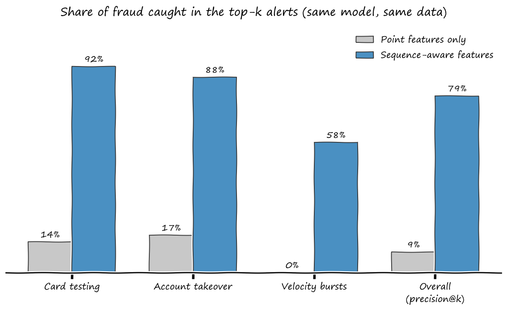

# Transaction Sequence Anomaly Detection

Point vs sequence-aware anomaly detection on synthetic card transactions.

Same model (Isolation Forest), same data, same seed. The only difference is whether each transaction can "see" its card's recent history.

| Metric | Point features | Sequence-aware |
|---|---|---|
| PR-AUC | 0.046 | 0.828 |
| Precision in top-k alerts | 9.2% | 79.1% |
| Card testing caught | 13.7% | 92.3% |
| Account takeover caught | 16.7% | 87.5% |
| Velocity bursts caught | 0.0% | 58.3% |



## Run it

```bash
pip install -r requirements.txt
python experiment.py   # ~10 seconds, prints the table above
python chart.py        # regenerates the chart
```

## What it does

- Simulates 2,000 cardholders over 30 days (~86,000 transactions)
- Injects three fraud patterns: card testing, account takeover, velocity bursts (0.76% of transactions)
- Compares point features (amount, hour, merchant category) with four leak-free sequence features: time since previous transaction, card-relative amount z-score, 10-minute transaction count, new merchant category flag

The data is synthetic, so exact numbers will not transfer to production. The direction of the result should.

## Author

Naveed Akram, Senior Solution Architect, secure payment infrastructure.
